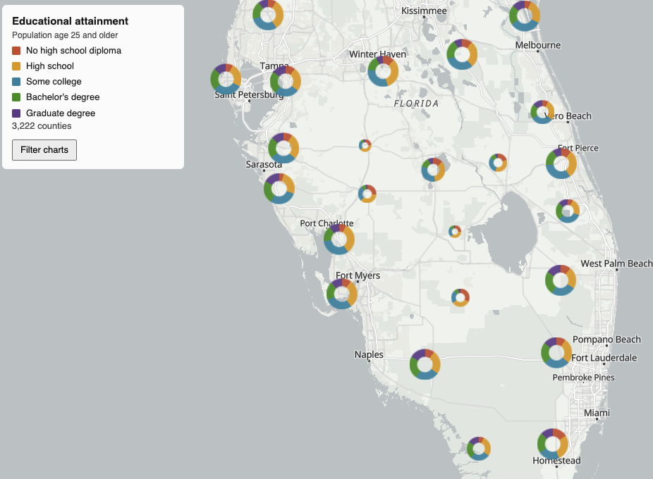

# maplibre-gl-pie-charts

[](https://www.npmjs.com/package/maplibre-gl-pie-charts)

**Add a WebGL pie or donut chart layer on a MapLibre GL JS or Mapbox GL JS map to compare share patterns across geographic units.**

A pie chart layer draws one chart on each feature of a map layer. If a feature has two or more non-negative numeric attributes, and those attributes are parts of a whole, the chart is a direct way to explore their shares. Each attribute becomes one slice, the wedge of the pie. The angle of that slice is the attribute's share of the feature's total, so a quick look shows how the mix differs from place to place.

The attributes can be any set of sub-categories you want to compare within a feature:

- Votes by candidate in a precinct, such as candidate A, candidate B, and the other candidates
- Languages spoken at home in a census tract, such as English, Spanish, and Chinese
- Land use or vegetation type in a subdivision, such as forest, cropland, and developed land
- Educational attainment in a county, such as no high school diploma, high school, some college, a bachelor's degree, and a graduate degree

Read the wedges as composition, not as a ranking. People judge angle and area poorly, so a pie chart is a weak way to decide which category is largest by a small margin. It is a better fit for seeing diversity and broad geographic patterns: where one group dominates, where the mix is even, and where that mix changes across the map. The [ArcGIS Maps SDK for JavaScript](https://developers.arcgis.com/javascript/latest/visualization/data-driven-styles/charts/) describes the same use of pie charts on features.

## A layer for MapLibre and Mapbox

This package adds a pie or donut chart layer to a MapLibre GL JS or Mapbox GL JS map. One chart is drawn for each feature, from the numeric attributes you choose. Every chart can share one uniform radius, or the radius can follow a step scale based on the sum of the slice values.

<p align="center">
  
  
</p>

Educational attainment for counties, viewed over Florida. These charts use a step radius, so a county with a larger total is drawn larger. The map on the left uses solid pies. The map on the right uses donuts.

A donut is that same chart with a round hole in the middle. The `hole` option is a fraction of the chart's radius. A value of 0 leaves a solid pie, and any greater value opens a hole. A `hole` of 0.5, for example, makes the hole half as wide as the chart. The ring can look lighter than a filled pie, and the open center is a place for a label if you want one. The [ArcGIS Maps SDK for JavaScript](https://developers.arcgis.com/javascript/latest/visualization/data-driven-styles/charts/) describes the same donut option for its pie chart renderer.

## Quick start

### 0 Installation

Use 0 (1) when the page is built from installed packages. Use 0 (2) when the page is one HTML document.

#### 0 (1) Install with npm

Install one map library. The layer is added to a map you create.

```bash
npm install maplibre-gl
```

```bash
npm install mapbox-gl
```

Install the reader for the file type you will use. GeoJSON needs no extra package. For GeoParquet:

```bash
npm install hyparquet hyparquet-compressors
```

For FlatGeobuf:

```bash
npm install flatgeobuf
```

Then install this package:

```bash
npm install maplibre-gl-pie-charts
```

Import the class from the package name:

```js
import {PieChartLayer} from 'maplibre-gl-pie-charts';
```

#### 0 (2) Load from a single HTML document

MapLibre GL JS is imported from its ESM build. The stylesheet is a separate link, and this package is imported in the same module script.

```html
<link rel="stylesheet" href="https://unpkg.com/maplibre-gl@^6.18.0/dist/maplibre-gl.css">
<script type="module">
    import * as maplibregl from 'https://unpkg.com/maplibre-gl@^6.18.0/dist/maplibre-gl.mjs';
    import {PieChartLayer} from 'https://cdn.jsdelivr.net/npm/maplibre-gl-pie-charts@0.1.0/dist/index.mjs';
</script>
```

Mapbox GL JS is loaded from a script tag. Import this package in a module script after it.

```html
<link rel="stylesheet" href="https://cdn.jsdelivr.net/npm/mapbox-gl@3/dist/mapbox-gl.css">
<script src="https://cdn.jsdelivr.net/npm/mapbox-gl@3/dist/mapbox-gl.js"></script>
<script type="module">
    import {PieChartLayer} from 'https://cdn.jsdelivr.net/npm/maplibre-gl-pie-charts@0.1.0/dist/index.mjs';
</script>
```

A page that reads GeoParquet or FlatGeobuf also needs an import map. The package loads those readers by bare name, and the map points each name at its file. Place the map before the module script. GeoJSON needs no map.

For GeoParquet:

```html
<script type="importmap">
{
    "imports": {
        "hyparquet": "https://cdn.jsdelivr.net/npm/hyparquet@1.33.0/src/index.js",
        "hyparquet-compressors": "https://cdn.jsdelivr.net/npm/hyparquet-compressors@1.1.3/src/index.js",
        "fzstd": "https://cdn.jsdelivr.net/npm/fzstd@0.1.1/esm/index.mjs",
        "hysnappy": "https://cdn.jsdelivr.net/npm/hysnappy@1.1.1/js/index.js"
    }
}
</script>
```

For FlatGeobuf, `flatgeobuf/generic` imports the other three names:

```html
<script type="importmap">
{
    "imports": {
        "flatgeobuf/generic": "https://cdn.jsdelivr.net/npm/flatgeobuf@4.6.1/dist/esm/generic.js",
        "flatbuffers": "https://cdn.jsdelivr.net/npm/flatbuffers@25.9.23/+esm",
        "slice-source": "https://cdn.jsdelivr.net/npm/slice-source@0.4.1/+esm",
        "@repeaterjs/repeater": "https://cdn.jsdelivr.net/npm/@repeaterjs/repeater@3.1.0/+esm"
    }
}
</script>
```

### 1 (1) Initialize with a file URL

Pass `url` pointing at one GeoParquet, FlatGeobuf, or GeoJSON file. The extension selects the reader. The check is case-insensitive and uses the path before any `?` or `#`.

| Extension | Format |
| --- | --- |
| `.parquet`, `.geoparquet` | GeoParquet |
| `.fgb` | FlatGeobuf |
| `.geojson`, `.json` | GeoJSON |

- Any other extension is rejected.
- A `.json` file is read as GeoJSON.
- A GeoParquet file is read from the column dictated by the constructor option `geometryColumn`, which defaults to `geometry`.
- `slices` names the numeric attributes, and `colors` supplies one color for each slice, in the same order.

  > **Warning:** At least 2 slices and at most 8 slices are supported. `slices` and `colors` must be the same length, so both arrays are limited to that range.

- Point geometry is recommended. One coordinate pair per feature is smaller to transfer and faster to parse. Other geometry is still drawn, with each chart placed at one anchor:
  - A `Point` uses its coordinate.
  - A `MultiPoint` or `LineString` uses the midpoint of its first two positions. A single position is used as it is.
  - A `MultiLineString` uses the midpoint of the first two positions of its first line.
  - A `Polygon` uses the centroid of its outer ring.
  - A `MultiPolygon` uses the centroid of the outer ring of its first polygon. The centroid can fall outside a concave ring.

```js
const pies = new PieChartLayer({
    id: 'education',
    url: './tl_2025_us_county_points.parquet',
    // geometryColumn: 'geometry' // only optionally applicable to GeoParquet
    slices: ['below_hs', 'high_school', 'some_college', 'bachelors', 'graduate'],
    colors: ['#c4533a', '#e09a3e', '#3d8ea6', '#5c8f3a', '#5b4d8a'],
});
```

### 1 (2) Initialize with data

Pass `data` when the GeoJSON is already in memory, and omit `url`. `data` is a GeoJSON `FeatureCollection` or `Feature`. `slices` and `colors` are unchanged from 1 (1).

```js
const pies = new PieChartLayer({
    id: 'education',
    data: counties, // a GeoJSON FeatureCollection
    slices: ['below_hs', 'high_school', 'some_college', 'bachelors', 'graduate'],
    colors: ['#c4533a', '#e09a3e', '#3d8ea6', '#5c8f3a', '#5b4d8a'],
});
```

### 2 Adjust the radius

`radius` constructor option sets the chart size in CSS pixels. It defaults to 16.

A number is a uniform radius. Every chart is drawn at that size, and the number must be greater than 0.

```js
radius: 16,
```

A step scale varies the radius by the sum of a feature's slice values. `steps` is a list of `[total, size]` pairs, and the totals must increase. The first step whose total is greater than or equal to the sum supplies the size. Each size is fixed. A sum larger than every total uses `fallback`. Every size and `fallback` must be greater than 0.

Suppose one feature has a first slice of 3000, a second slice of 8000, and a third slice of 7500. The sum of those slice values is 18500. Given the following expression, 20000 is the first step whose total is greater than or equal to 18500, so the chart is drawn at 9 pixels.

```js
radius: {
    steps: [
        [8000, 6],
        [20000, 9],
        [50000, 13],
        [150000, 17],
    ],
    fallback: 22,
},
```

### 3 Add the layer to the map

Add the layer after the map style is ready.

```js
map.on('load', () => {
    map.addLayer(pies);
});
```

`loaded` is optional. The promise is created when the layer is added, so read it after `addLayer`. It resolves once the features are read and the charts are uploaded, and it rejects if that read fails. The [education demo](https://github.com/zwang-geog/maplibre-gl-pie-charts/blob/master/demos/us-education/index.html) uses it to report how many counties were drawn:

```js
map.on('load', () => {
    map.addLayer(pies);
    pies.loaded.then(() => {
        status.textContent = `${pies.count.toLocaleString()} counties`;
    }).catch((error) => {
        status.textContent = error.message;
    });
});
```

If the page toggles the basemap style, add the layer from `style.load` instead. A new style removes custom layers, and `style.load` runs for the first style and again after each change.

```js
map.on('style.load', () => {
    map.addLayer(pies);
});
```

### 4 Toggling the layer

#### 4 (1) Visible when the map loads

The layer is drawn as soon as it is added. Show or hide it with the `visibility` layout property. The first argument is the layer id. The same call works on MapLibre GL JS and Mapbox GL JS.

```js
map.setLayoutProperty('pie-layer', 'visibility', 'visible'); // show
map.setLayoutProperty('pie-layer', 'visibility', 'none');    // hide
```

#### 4 (2) Hidden until the user turns it on

Initialize the constructor with `readyForDisplay` set to `false`. The features are still read, and `render` draws nothing while the flag is false. After the layer is added, set its visibility to `none`, then allow rendering. Visibility still controls what the user sees, so the charts stay hidden until the user sets it back to `visible`.

```js
const pies = new PieChartLayer({
    id: 'pie-layer',
    url: './tl_2025_us_county_points.parquet',
    slices: ['below_hs', 'high_school', 'some_college', 'bachelors', 'graduate'],
    colors: ['#c4533a', '#e09a3e', '#3d8ea6', '#5c8f3a', '#5b4d8a'],
    radius: {
        steps: [
            [8000, 6],
            [20000, 9],
            [50000, 13],
            [150000, 17],
        ],
        fallback: 22,
    },
    readyForDisplay: false,
});

map.on('load', () => {
    map.addLayer(pies);
    map.setLayoutProperty('pie-layer', 'visibility', 'none');
    pies.readyForDisplay = true; // allow rendering; Mapbox visibility still controls what the user sees
});

map.setLayoutProperty('pie-layer', 'visibility', 'visible'); // show
```

## Class options

`PieChartLayer` takes these constructor options. Set `url` or `data`. `id`, `slices`, and `colors` are required.

| Option | Default | Description |
| --- | --- | --- |
| `id` | | Layer id. `map.addLayer` and `setLayoutProperty` use this string. |
| `url` | | URL of one whole GeoParquet, FlatGeobuf, or GeoJSON file. The extension selects the reader. See Quick start 1 (1). |
| `data` | | A GeoJSON `FeatureCollection` or `Feature` already in memory. See Quick start 1 (2). |
| `geometryColumn` | `geometry` | GeoParquet column that holds the geometry. An empty string is rejected. The option applies to a GeoParquet `url`. |
| `slices` | | Names of the numeric attributes, in slice order. Two to eight unique, non-empty strings. `colors` must be the same length. |
| `colors` | | One color for each slice, in the same order. A color is a `#hex` string, an `rgb()` or `rgba()` string, or a `[red, green, blue]` or `[red, green, blue, alpha]` array. Array channels above 1 are read as 0–255. Other array channels are 0–1. |
| `radius` | `16` | Chart size in CSS pixels. A number greater than 0 is a uniform radius. An object `{steps, fallback}` is a step scale. See Quick start 2. |
| `hole` | `0` | Inner radius as a fraction of the chart radius, from 0 to 1. `0` is a solid pie. `0.5` makes the hole half as wide as the chart. |
| `opacity` | `1` | Chart opacity, from 0 to 1. |
| `requestInit` | | [`RequestInit`](https://developer.mozilla.org/en-US/docs/Web/API/RequestInit) for a `url` request, such as headers or credentials. It is passed through for GeoParquet, FlatGeobuf, and GeoJSON files. |
| `slot` | | Mapbox GL JS slot name. The property is set on the layer only when this option is provided. |
| `readyForDisplay` | `true` | When `false`, `render` draws nothing. The features are still read. See Quick start 4 (2). |

## Limitations

The layer draws in the Mercator projection, and currently it is not compatible with globe projection on Mapbox GL JS and MapLibre GL JS. Each chart is placed with the Mercator matrix, so a globe view does not keep the charts on their features.

Initialize a Mapbox map with `projection` set to `mercator`:

```js
const map = new mapboxgl.Map({
    container: 'map',
    style: 'mapbox://styles/mapbox/dark-v11',
    zoom: 7,
    center: [-119.699944, 34.432546],
    projection: 'mercator', // Required. This layer does not draw on the globe.
});
```

Leave a MapLibre map on its Mercator projection. Do not set `projection` to `'globe'`.


